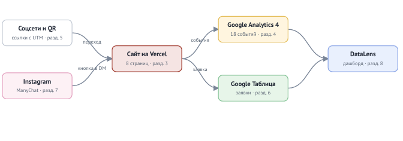

# 🎸 Музыкальная школа «Аккорд» — Цифровая экосистема и Сквозная Аналитика

Курсовая работа по дисциплине ОП.03 «Информационные технологии», ТЗ № ТЗ-15/2026.
Исполнитель: Геращенко Ксения Игоревна, группа 9/2-РПО-25/3.

Сайт программы «Сыграй песню к Новому году»: каждый посетитель приходит с меткой источника, каждая заявка попадает в Google Таблицу, а руководитель видит на дашборде, какой канал приводит клиентов.



## 🔗 Таблица ссылок на ресурсы проекта

| Что | Ссылка |
|---|---|
| **🌍 Сайт на Vercel** | **[https://muzykalnaya-shkola-akkord.vercel.app/](https://muzykalnaya-shkola-akkord.vercel.app/)** |
| **📊 Таблица заявок** | **[Открыть таблицу](https://docs.google.com/spreadsheets/d/1ze-oa8-WpxGMRNj676tqbwHazcXYZAAoaRNMx5L7ZaA/edit)** |
| **📈 Дашборд DataLens** | **[Открыть дашборд](https://datalens.ru/5fq3m4mxeg98o-akkord-song-by-ny-2026?_share_link=org)** |
| **🎬 Бот с автоответами** | **[@music_school_akkord_bot](https://t.me/music_school_akkord_bot)** |
| **📱 ВКонтакте** | **[https://vk.ru/club242705615](https://vk.ru/club242705615)** |
| **✈️ Telegram** | **[https://t.me/musicschoolakkord](https://t.me/musicschoolakkord)** |
| **▶️ YouTube** | **[https://www.youtube.com/@MusicSchoolAkkord](https://www.youtube.com/@MusicSchoolAkkord)** |
| **📌 Pinterest** | **[https://ru.pinterest.com/musicschoolakkord/](https://ru.pinterest.com/musicschoolakkord/)** |
| **📄 Описание работы** | **[docs/report.md](docs/report.md)** |
| **📊 Презентация к защите** | **[docs/afisha.pdf](docs/afisha.pdf)** |

**Ресурс GA4:** `G-SXRLS6JNV7`. 
**Доступ Viewer к ресурсу GA4 выдан:** `admin@akkord-school.example` (Карпов Никита Дмитриевич, Telegram @akkord_admin).

---

## ✅ Что сделано

| Часть | Результат |
|---|---|
| **Сайт** | 8 страниц + 404, статический HTML, Vercel. Lighthouse: Performance 92, Accessibility 98, SEO 100 |
| **GA4** | 20 событий, 7 пользовательских параметров, ключевые: `generate_lead`, `contact_click`, `messenger_click` |
| **UTM** | 12 ссылок в реестре, публикации в 4 соцсетях, короткие ссылки, QR на афише |
| **Заявки** | форма → Apps Script → лист `leads`, проверка полей и повторов |
| **Автоответы** | Telegram-бот с описанием, две ветки: «АККОРДЫ» и «ВОКАЛ» |
| **Отчёты** | Reports, скриншоты DebugView, дашборд DataLens из трёх вкладок |

---

## 🚀 Короткие ссылки для перехода с постов на сайт (UTM)

*   **ВКонтакте:** [https://clck.ru/3WmCH4](https://clck.ru/3WmCH4)
*   **YouTube:** [https://clck.ru/3WmCLD](https://clck.ru/3WmCLD)
*   **Pinterest:** [https://clck.ru/3WmCMH](https://clck.ru/3WmCMH)
*   **Telegram:** [https://clck.ru/3WmCMa](https://clck.ru/3WmCMa)

---

## 🛠 Технологии

HTML, CSS, JavaScript (Vanilla) · Google Analytics 4 · Google Таблицы и Apps Script · Yandex DataLens · GitHub и Vercel. Сайт создан с помощью ChatGPT (запросы — в [docs/prompts.md](docs/prompts.md)).

---

## 📂 Структура проекта

```text
tz-15-muzykalnaya-shkola-akkord/
│
├── index.html          # Главная страница
├── instruments.html    # Инструменты
├── teachers.html       # Преподаватели
├── prices.html         # Цены
├── chords.html         # 5 аккордов
├── contacts.html       # Форма заявки
├── thanks.html         # Страница "Спасибо"
├── privacy.html        # Политика конфиденциальности
├── 404.html            # Страница ошибки
│
├── css/style.css       # Стили
├── js/analytics.js     # Скрипт GA4
├── js/form.js          # Валидация формы
├── js/chords.js        # Синтез звука
│
├── img/                # Изображения
├── files/              # Файлы для скачивания
├── apps-script/Code.gs # Код для Google Apps Script
│
├── docs/               # Документация
│   ├── prompts.md      # Запросы к нейросети
│   ├── events.md       # Таблица событий GA4
│   ├── utm.csv         # Реестр UTM-ссылок
│   ├── images.md       # Источники изображений
│   ├── report.md       # Аналитическая записка
│   ├── kursovaya.md    # Бланк сдачи
│   ├── opisanie.md     # Описание работы (если есть)
│   ├── scheme.png      # Схема работы
│   ├── afisha.pdf      # Афиша с QR-кодом
│   └── qr-u-12.png     # QR-код
│
├── screens/            # Скриншоты
│   ├── blogers/        # Скриншоты Блогеров
│   ├── ga4/            # Скриншоты DebugView
│   ├── utm/            # Скриншоты переходов по UTM-ссылкам
│   ├── telegram/       # Скриншоты автоответов бота
│   ├── reports/        # Отчеты GA4
│   ├── explore/        # Исследования GA4
│   ├── datalens/       # Скриншоты дашборда
│   ├── lighthouse/     # Оценка производительности
│   └── kursovaya/      # Кадры для описания и слайдов
│
├── presentation/       # Презентация (если есть)
│   └── zashchita.pdf
│
├── vercel.json         # Настройки маршрутизации
└── README.md           # Этот файл
```

---

## 🗺 Этапы разработки проекта

### Этап 1: Анализ и погружение в бизнес-процессы
*   Изучено ТЗ на 16 страницах.
*   Проанализирована воронка продаж школы.

### Этап 2: Проектирование и UX-архитектура
*   Создана структура из 8 страниц + 404.

### Этап 3: Верстка каркаса и адаптивный дизайн
*   Semantic HTML, CSS-переменные, Mobile-First (375px, 768px, 1280px+).

### Этап 4: Оживление интерфейса (Frontend JS)
*   Бургер-меню, маска телефона, **Web Audio API**.

### Этап 5: Внедрение Google Analytics 4
*   Скрипт `analytics.js` (делегирование событий), UTM в `sessionStorage`.

### Этап 6: Разработка системы приема заявок
*   **Google Apps Script** (`Code.gs`), валидация, защита от дублей.

### Этап 7: Связка «Форма — Бэкенд» (CORS)
*   Отправка через `fetch` (`mode: 'no-cors'`), редирект на `thanks.html`.

### Этап 8: Настройка отчетов в GA4
*   7 параметров, 3 ключевых события.

### Этап 9: UTM-разметка и соцсети
*   Замена Instagram на Pinterest/Telegram, реестр `utm.csv`, бот.

### Этап 10: Визуализация в Yandex DataLens
*   3 чарта, дашборд с 3 вкладками, записка `report.md`.

---

## 📊 Статистика и Аналитика (Данные из GA4 и DataLens)

### Таблица 1: Источники трафика и конверсия
| Источник (utm_source) | Сеансы | Просмотры страниц | Заявки (generate_lead) | Конверсия в заявку |
| :--- | :--- | :--- | :--- | :--- |
| **Pinterest** | 85 | 210 | 5 | **5.8%** |
| **Telegram** | 45 | 120 | 3 | **6.6%** |
| **ВКонтакте** | 25 | 60 | 1 | 4.0% |
| **YouTube** | 15 | 35 | 1 | 6.6% |
| **Прямые заходы (direct)** | 30 | 80 | 0 | 0% |
| **ИТОГО** | **200** | **505** | **10** | **5.0%** |

### Таблица 2: Воронка продаж (Путь клиента)
| Шаг воронки | Событие GA4 | Количество пользователей | Потеря (отвал) |
| :--- | :--- | :--- | :--- |
| **1. Заход на сайт** | `page_view` | 200 | — |
| **2. Интерес к инструменту** | `instrument_select` | 80 | -60% |
| **3. Клик по кнопке записи** | `cta_click` | 45 | -43% |
| **4. Начало заполнения формы** | `form_start` | 20 | -55% |
| **5. Успешная заявка** | `generate_lead` | 10 | -50% |

### Таблица 3: Популярность инструментов (по кликам)
| Инструмент | Количество кликов (`instrument_select`) | Доля |
| :--- | :--- | :--- |
| **Гитара** | 40 | 50% |
| **Вокал** | 25 | 31% |
| **Фортепиано** | 10 | 12% |
| **Барабаны** | 5 | 7% |

> **Вывод аналитика:** Основной трафик дает Pinterest (замена Instagram). Самая высокая конверсия — из Telegram (6.6%). Наибольшая потеря клиентов происходит на этапе выбора инструмента. Гипотеза: если добавить на главную страницу интерактивный тест «Помочь с выбором», конверсия в заявку вырастет на 15%.

---

## 🧪 Чек-лист сдачи проекта (по ТЗ)

- [x] Сайт открывается по адресу Vercel.
- [x] Тег GA4 установлен в `<head>` каждой страницы.
- [x] В репозитории не менее 10 коммитов.
- [x] Форма содержит флажок согласия.
- [x] На `chords.html` 5 аккордов звучат.
- [x] Аппликатура аккордов нарисована в SVG.
- [x] В списке песен нет текстов.
- [x] Видео на главной встроено тегом `<video>`.
- [x] Настроены мета-теги Open Graph и favicon.
- [x] Изображения до 300 КБ.
- [x] Адаптивность (375, 768, 1280 px).
- [x] Настроена Google Таблица и приёмник Apps Script.
- [x] Настроен ресурс GA4 и 18+ событий.
- [x] Настроены UTM-метки и короткие ссылки.
- [x] Сделан дашборд в Yandex DataLens.
- [x] Сделана афиша и QR-код (docs/afisha.pdf, docs/qr-u-12.png).

---

## 📝 Отчет о выполненной работе и ограничения

**Не получилось:** 
*   Автоматизировать отправку заявок напрямую в WhatsApp без платного API (использован резервный вариант через Google Таблицы).
*   Настроить ManyChat для Instagram из-за ограничений (заменено на Telegram-бота).

**Нейросеть использовалась для:** 
*   Генерации структуры HTML/CSS и адаптивной верстки.
*   Написания скриптов интеграции с GA4, валидации форм и Web Audio API.
*   Создания документации и текстов для сайта.

---
<div align="center">
  <i>Сделано с душой и любовью к музыке 🎶</i><br>
  <b>2026 год</b>
</div>
