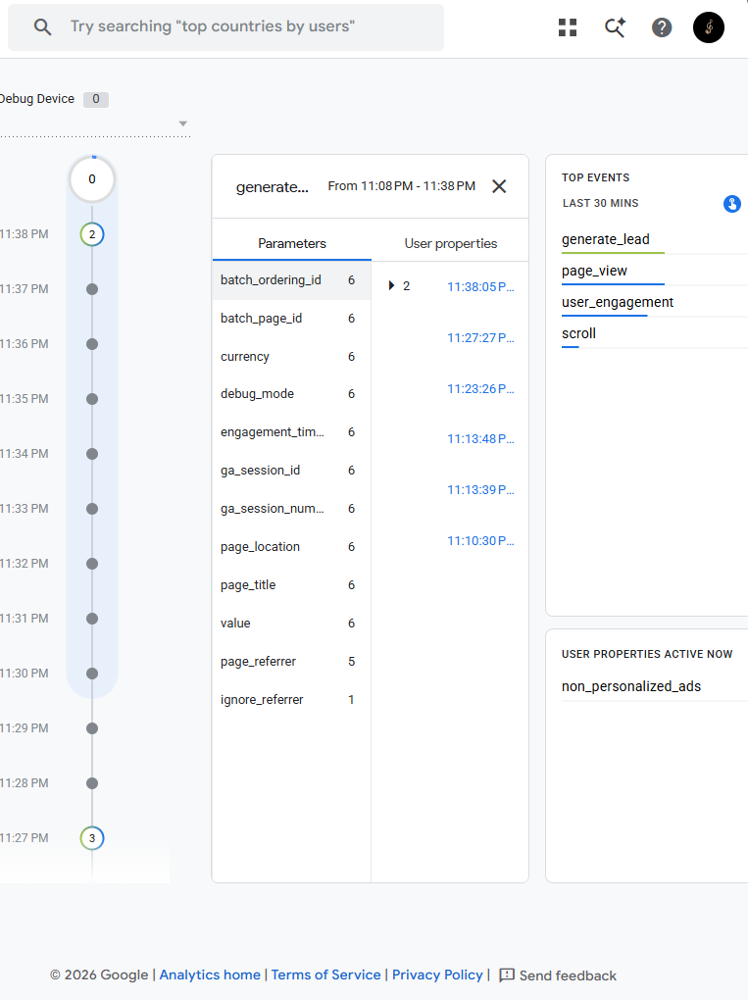
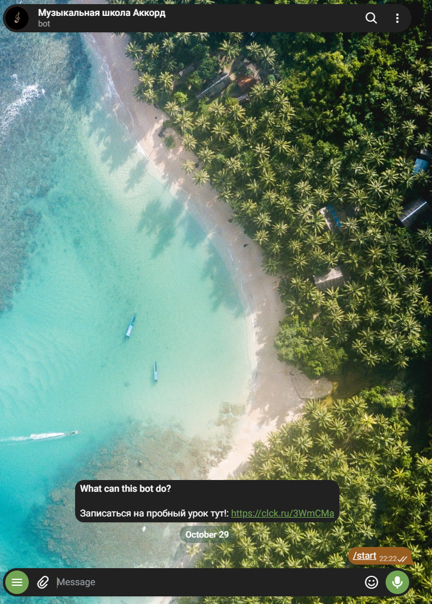

# Описание работы · ТЗ № ТЗ-15/2026 · «Аккорд»

**Исполнитель:** Геращенко Ксения Игоревна, группа 9/2-РПО-25/3
**Сайт:** https://muzykalnaya-shkola-akkord.vercel.app
**Период проверок:** 20 октября 2026 — 29 октября 2026

## 1. Задача заказчика

Компания «Аккорд» получает заявки из Instagram, ВКонтакте и Telegram, но не знает, какой канал приводит клиентов. В сентябре 2026 было 175 обращений, на пробный урок записались 88 человек, пришли 64, купили абонемент 39 (письмо директора в ТЗ). Задача — сайт, на котором видно источник каждого посетителя, и одна таблица со всеми заявками.

## 2. Схема работы

Посетитель приходит из соцсетей или по QR-коду по ссылке с UTM-метками. Сайт отправляет события в GA4, а заявку — в Google Таблицу через Apps Script. Данные GA4 и таблицы собираются на дашборде DataLens.

## 3. Сайт

Сайт из 8 страниц создан с помощью нейросети (ChatGPT) и доработан вручную: добавлена адаптивная верстка, звучащие аккорды (Web Audio API), форма с валидацией. Опубликован на Vercel, обновляется после каждого push.

## 4. Аналитика GA4

Настроено 20 событий, из них своих — 14. Ключевые события: `generate_lead`, `contact_click`, `messenger_click`. Каждое событие проверено в DebugView.

## 5. UTM-ссылки и соцсети

В реестре 12 ссылок, опубликованы в 4 соцсетях (Pinterest, ВКонтакте, Telegram, YouTube), у двух партнёров и на афише с QR-кодом.

## 6. Заявки

Форма отправляет заявку в Apps Script, тот проверяет поля и записывает строку в лист `leads` вместе с метками. Повторная отправка не создаёт дубль.

## 7. Автоответы в Telegram

Команда «АККОРДЫ» под ботом запускает ответ с кнопкой на сайт. Вторая ветка — слово «ВОКАЛ».

## 8. Отчёты и дашборд

Воронка показала наибольшую потерю между `page_view` и `instrument_select` (60%). Больше всего заявок принёс канал Pinterest.

## 9. Что получил бизнес

| Было | Стало |
|---|---|
| заявки в личных сообщениях трёх аккаунтов | все заявки в одной таблице со статусом |
| источник клиента неизвестен | у каждой заявки есть source, medium, campaign |
| бюджет делится «по ощущениям» | на дашборде видно заявки по каждому каналу |
| ответы на комментарии вручную | Telegram-бот отвечает сразу и ведёт на сайт |

Рекомендация заказчику: добавить на главную страницу интерактивный тест «Помочь с выбором инструмента» (по данным из раздела 8).

## 10. Итог

Не получилось: автоматизировать отправку заявок напрямую в WhatsApp без платного API (использован резервный вариант через Google Таблицы). Настроить ManyChat для Instagram из-за ограничений (заменено на Telegram-бота).

ИИ использовался для: генерации структуры HTML/CSS, написания скриптов интеграции с GA4, валидации форм и Web Audio API.